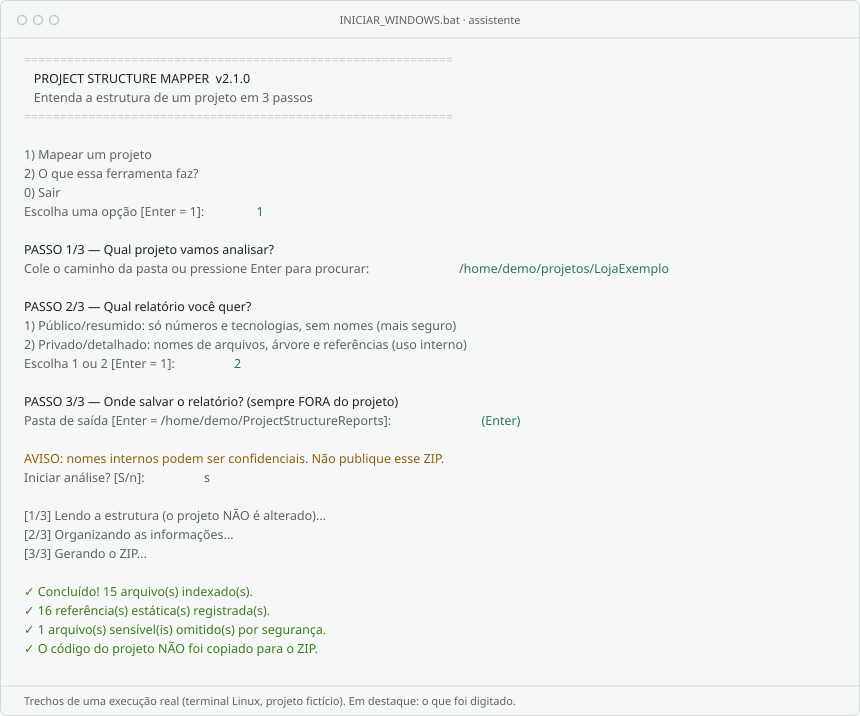
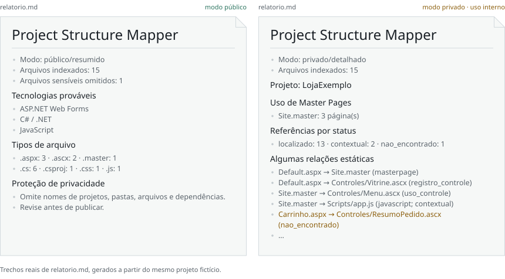

<picture>
  <source media="(max-width: 600px) and (prefers-reduced-motion: reduce) and (prefers-color-scheme: dark)" srcset="docs/img/banner-mobile-dark-static.svg">
  <source media="(max-width: 600px) and (prefers-reduced-motion: reduce)" srcset="docs/img/banner-mobile-light-static.svg">
  <source media="(max-width: 600px) and (prefers-color-scheme: dark)" srcset="docs/img/banner-mobile-dark.svg">
  <source media="(max-width: 600px)" srcset="docs/img/banner-mobile-light.svg">
  <source media="(prefers-reduced-motion: reduce) and (prefers-color-scheme: dark)" srcset="docs/img/banner-dark-static.svg">
  <source media="(prefers-reduced-motion: reduce)" srcset="docs/img/banner-light-static.svg">
  <source media="(prefers-color-scheme: dark)" srcset="docs/img/banner-dark.svg">
  
</picture>

**Mapeador local, gratuito e guiado em português — Python, Node.js e ASP.NET Web Forms.**

**[Instalar e começar](#comece-aqui-windows-10-e-11) · [Comandos CMD](#uso-pelo-cmd-prompt-de-comando) · [Relatórios](#resultados-gerados) · [Ajuda para iniciantes](docs/GUIA_WINDOWS.md)**

---

## O que é?

Recebeu um projeto grande e não sabe por onde começar? O **Project Structure Mapper** cria um mapa do repositório para ajudar a identificar tecnologias, pastas, arquivos e relações estáticas.

| Perfil | O que você consegue fazer |
| --- | --- |
| **Iniciante** | Usar um menu passo a passo, sem precisar aprender CMD |
| **Desenvolvedor** | Enxergar a estrutura rapidamente |
| **Legado ASP.NET** | Relacionar páginas, Master Pages, controles e arquivos declarados |
| **Equipe técnica** | Gerar relatórios locais sem copiar o código-fonte |

> **Privacidade primeiro:** a ferramenta lê os arquivos localmente, não altera a pasta analisada e não envia o projeto para a internet. O relatório é salvo em outra pasta. Ainda assim, revise qualquer resultado antes de compartilhar.

## Comece aqui: Windows 10 e 11

**Requisito:** Python 3.8 ou mais recente. **Não precisa instalar Git, Visual Studio ou bibliotecas Python adicionais.**

1. **Instale o Python:** [python.org/downloads](https://www.python.org/downloads/). Marque **Add python.exe to PATH** caso essa opção apareça no instalador.
2. **Baixe os arquivos do projeto:** no GitHub, clique em **Code → Download ZIP** e extraia o ZIP. É preciso extrair antes de executar.
3. **Abra a pasta extraída** e confirme que existem os arquivos **INICIAR_WINDOWS.bat** e **mapper.py**.
4. **Dê dois cliques em INICIAR_WINDOWS.bat**. Uma janela do Prompt de Comando vai abrir.
5. Escolha **1 — Mapear um projeto** (ou pressione Enter).
6. Cole o caminho da pasta que quer analisar, ou pressione Enter para tentar abrir a janela de seleção.
7. Escolha **1 — Público/resumido** ou **2 — Privado/detalhado**.
8. Pressione Enter para usar a pasta de saída padrão ou escolha outra **fora da pasta analisada**.
9. Confira o resumo, confirme e, ao concluir, abra a pasta dos resultados.

**Atalho:** arraste a pasta do projeto **sobre o INICIAR_WINDOWS.bat**. O assistente recebe o caminho automaticamente.

**Assim fica o assistente** (trechos de uma execução real, com um projeto fictício):

<picture>
  <source media="(prefers-color-scheme: dark)" srcset="docs/img/assistente-dark.svg">
  
</picture>

> **Status de validação:** a versão v2 já está publicada na branch **main**. O arquivo BAT e o seletor gráfico **ainda precisam de teste num Windows físico**; use primeiro uma pasta de testes e revise os resultados.

<strong>Como reconhecer a pasta correta depois da extração?</strong>

~~~text
Project-Structure-Mapper/
├── INICIAR_WINDOWS.bat   ← dois cliques
├── mapper.py              ← programa Python
├── README.md              ← este guia
└── tests/
    └── test_mapper.py
~~~

Se a pasta não contém mapper.py e INICIAR_WINDOWS.bat, verifique se baixou a branch main atualizada e extraiu o ZIP completo.

## Uso pelo CMD (Prompt de Comando)

**CMD** é o terminal clássico do Windows 10 e 11. O aplicativo **não exige que você saiba usá-lo**, mas aqui estão os comandos para executar e entender.

1. No **Explorador de Arquivos**, entre na pasta que contém **mapper.py**.
2. Clique na barra de endereço dessa pasta, digite **cmd** e pressione **Enter**.
3. Na janela que abrir, digite um dos comandos a seguir.

**Verificar se o Python está instalado:**

~~~bat
py -3 --version
~~~

**Abrir o assistente pelo terminal:**

~~~bat
INICIAR_WINDOWS.bat
~~~

Ou, diretamente pelo Python:

~~~bat
py -3 mapper.py
~~~

**Mapear um projeto de exemplo no modo público (sem menu):**

~~~bat
py -3 mapper.py "C:\Projetos\MeuProjeto" --mode public
~~~

**Gerar relatório detalhado em uma pasta separada:**

~~~bat
py -3 mapper.py "C:\Projetos\MeuProjeto" --mode private --output "%USERPROFILE%\Documents\RelatoriosMapper"
~~~

**Mostrar ajuda:**

~~~bat
py -3 mapper.py --help
~~~

Substitua **C:\Projetos\MeuProjeto** pelo caminho real da pasta a analisar. Use **aspas** para caminhos com espaços.

Se **py** não for reconhecido, tente **python --version**. Caso funcione, use **python** no lugar de **py -3**.

**[Tutorial completo: CMD, download, pasta de saída e resolução de erros](docs/GUIA_WINDOWS.md)**

## Resultados gerados

A cada execução, é criada uma **nova pasta de saída**. Os relatórios não ficam dentro do projeto analisado.

| Arquivo | Público | Privado | Conteúdo |
| --- | :---: | :---: | --- |
| **relatorio.md** | ✓ | ✓ | Resumo para leitura |
| **estrutura.json** | ✓ | ✓ | Dados estruturados |
| **arvore.txt** | — | ✓ | Árvore de pastas e arquivos |
| **mapa_do_projeto.zip** | ✓ | ✓ | Pacote dos relatórios, sem código-fonte |

**A diferença entre os dois modos**, no mesmo projeto fictício:

<picture>
  <source media="(prefers-color-scheme: dark)" srcset="docs/img/relatorios-dark.svg">
  
</picture>

- **Modo público (padrão):** estatísticas e tecnologias prováveis, sem nomes de projeto, pastas ou arquivos.
- **Modo privado:** inclui a estrutura interna, árvore e referências de arquivos; **somente para uso autorizado**.

### O que reconhece?

- **ASP.NET Web Forms:** páginas .aspx, controles .ascx, Master Pages .master, diretivas Page, Master, Control, Register, Reference e MasterType; registros de controles de Web.config na raiz e subpastas.
- **Python:** arquivos .py e sinais de projeto como pyproject.toml e requirements.txt.
- **Node.js / TypeScript:** arquivos package.json, JavaScript, TypeScript e TSX.
- **Referências estáticas:** os estados **localizado**, **nao_encontrado** e **contextual** (o último não significa necessariamente erro).

## Como funciona por dentro

Tudo acontece em **mapper.py**, numa sequência de etapas que só leem arquivos:

| Etapa | Função | O que faz |
| --- | --- | --- |
| **1. Inventário** | inventory | Percorre a pasta, pula dependências e builds (node_modules, bin, obj...) e para em 25.000 arquivos |
| **2. Filtro de segurança** | classify_name | Separa o que é código, o que não interessa e o que é **sensível** (.env, Web.config, nomes com senha ou token), que nunca entra no relatório |
| **3. Tecnologias** | detect_tech | Deduz as tecnologias pelas extensões e por manifestos como package.json e pyproject.toml |
| **4. Referências Web Forms** | links_for_file | Lê diretivas Page, Master, Control e Register e liga cada página ao code-behind, à Master Page e aos controles, resolvendo caminhos como o IIS (sem diferenciar maiúsculas) |
| **5. Relatórios** | generate | Monta relatorio.md, estrutura.json e, no modo privado, arvore.txt; depois cria o ZIP numa pasta nova, **fora do projeto** |

Cada referência recebe um estado: **localizado** (o arquivo existe), **nao_encontrado** (o caminho declarado não existe na pasta) ou **contextual** (depende da URL no navegador, então não dá para afirmar só lendo os arquivos).

Os testes provam a promessa principal: calculam um **hash** de todos os arquivos do projeto de teste antes e depois do mapeamento e falham se qualquer byte mudar.

## Segurança e limitações

- Usa apenas a **biblioteca padrão do Python**, sem instalar pacotes extras.
- Não modifica, executa, compila ou copia o código do projeto analisado.
- Não envia telemetria nem acessa a rede durante o mapeamento.
- Recusa saída dentro do projeto e não percorre links simbólicos.
- Ignora arquivos e pastas sensíveis ou gerados. Em Web Forms, lê apenas registros estáticos de controles do Web.config, **sem exportar o conteúdo do arquivo**.
- **Não** verifica a qualidade do software, o banco de dados, a segurança real nem referências geradas dinamicamente.

> **Projetos corporativos:** não coloque arquivos internos, relatórios privados, credenciais ou dados de clientes neste repositório. Mesmo um relatório público precisa de revisão antes de ser divulgado.

## Testes e status de validação

A implementação v2 registra **34 testes automatizados aprovados em Linux** com Python 3.8, 3.11, 3.12 e 3.13, conforme o histórico do [PR #1](https://github.com/mateuscengeroff-prog/Project-Structure-Mapper/pull/1).

Para rodar os testes localmente:

~~~bat
py -3 -m unittest discover -s tests -v
~~~

**Ainda não homologado em Windows real:** duplo clique no BAT, arrastar e soltar, seleção gráfica de pasta e abertura da pasta de resultados. Não confundir testes executados em Linux com validação no Windows.

## Dúvidas e soluções

Consulte **[Guia para iniciantes — Windows 10/11](docs/GUIA_WINDOWS.md#solução-de-problemas)** para Python não reconhecido, aviso do Windows, janela de seleção ausente, caminhos com espaços e relatórios recusados.

## Arquivos do projeto

~~~text
INICIAR_WINDOWS.bat     Inicializador no Windows
mapper.py               Mapeador e assistente interativo
tests/test_mapper.py    Testes automatizados
docs/GUIA_WINDOWS.md    Tutorial de instalação e CMD
docs/img/               Ilustrações deste README
README.md               Esta apresentação
~~~

As ilustrações em docs/img são SVGs desenhados em código, na mesma identidade visual do [perfil do autor](https://github.com/mateuscengeroff-prog). O assistente e os relatórios reproduzem uma execução real sobre um projeto fictício; não são capturas de tela. Para regerá-las, rode `python scripts/repo_art.py mapper <pasta>` no repositório do perfil.

## Licença e contribuições

Este repositório está em desenvolvimento. **Ainda não há licença de código aberto definida**; não presuma autorização de redistribuição ou uso comercial. Antes de torná-lo público, escolha uma licença e revise a segurança dos arquivos e relatórios.

**Um mapa mais claro do projeto, sem tocar no seu código.**

[Voltar ao início](#project-structure-mapper)

