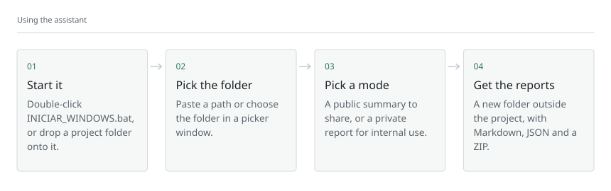
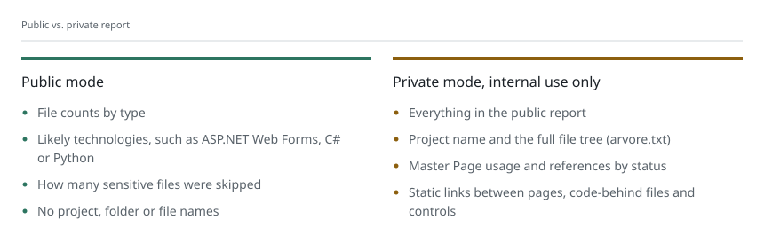

<picture>
  <source media="(max-width: 600px) and (prefers-reduced-motion: reduce) and (prefers-color-scheme: dark)" srcset="docs/img/banner-mobile-dark-static.svg">
  <source media="(max-width: 600px) and (prefers-reduced-motion: reduce)" srcset="docs/img/banner-mobile-light-static.svg">
  <source media="(max-width: 600px) and (prefers-color-scheme: dark)" srcset="docs/img/banner-mobile-dark.svg">
  <source media="(max-width: 600px)" srcset="docs/img/banner-mobile-light.svg">
  <source media="(prefers-reduced-motion: reduce) and (prefers-color-scheme: dark)" srcset="docs/img/banner-dark-static.svg">
  <source media="(prefers-reduced-motion: reduce)" srcset="docs/img/banner-light-static.svg">
  <source media="(prefers-color-scheme: dark)" srcset="docs/img/banner-dark.svg">
  
</picture>

**A free, local mapper with a guided assistant. Python, Node.js and ASP.NET Web Forms.**

**[Get started](#get-started-windows-10-and-11) · [Command line](#command-line-usage) · [Reports](#what-you-get) · [Beginner's guide](docs/WINDOWS_GUIDE.md)**

---

## What it is

Handed a large project and not sure where to start? **Project Structure Mapper** builds a map of a repository so you can see its technologies, folders, files and static relationships at a glance.

| Who | What it helps with |
| --- | --- |
| **Beginners** | A step-by-step menu; no need to learn the command line |
| **Developers** | A quick picture of how a codebase is laid out |
| **Legacy ASP.NET** | Links between pages, Master Pages, user controls and declared files |
| **Teams** | Local reports that never copy the source code |

> **Privacy first:** the tool reads files locally, never changes the folder it analyses and never sends the project anywhere. Reports are saved in a separate folder. Still, review any report before sharing it.

> **Interface language:** the assistant's menus and the generated reports are in Portuguese, the author's native language. Everything else in this repository is in English.

## Get started: Windows 10 and 11

**Requirement:** Python 3.8 or newer. **No Git, Visual Studio or extra Python packages needed.**

1. **Install Python** from [python.org/downloads](https://www.python.org/downloads/). Tick **Add python.exe to PATH** if the installer shows it.
2. **Download the project:** on GitHub, click **Code → Download ZIP**, then extract the ZIP. It must be extracted before you run it.
3. **Open the extracted folder** and check that it contains **INICIAR_WINDOWS.bat** and **mapper.py**.
4. **Double-click INICIAR_WINDOWS.bat**. A Command Prompt window opens.
5. Choose **1 (map a project)**, or just press Enter.
6. Paste the path of the folder to analyse, or press Enter to open a folder picker.
7. Choose **1 (public summary)** or **2 (private, detailed report)**.
8. Press Enter to use the default output folder, or pick another one **outside the analysed folder**.
9. Check the summary, confirm, and open the results folder when it finishes.

**Shortcut:** drag the project folder **onto INICIAR_WINDOWS.bat**. The assistant starts with the path already filled in.

<picture>
  <source media="(max-width: 600px) and (prefers-color-scheme: dark)" srcset="docs/img/flow-mobile-dark.svg">
  <source media="(max-width: 600px)" srcset="docs/img/flow-mobile-light.svg">
  <source media="(prefers-color-scheme: dark)" srcset="docs/img/flow-dark.svg">
  
</picture>

> **Validation status:** version 2 is on the **main** branch and was **tested by the author on a physical Windows machine** on 4 November 2026, in addition to the automated tests. As with any tool, try it on a test folder first and review the results.

<strong>How do I know I extracted the right folder?</strong>

~~~text
Project-Structure-Mapper/
├── INICIAR_WINDOWS.bat   ← double-click this
├── mapper.py              ← the Python program
├── README.md              ← this guide
└── tests/
    └── test_mapper.py
~~~

If the folder has no mapper.py and INICIAR_WINDOWS.bat, check that you downloaded the up-to-date main branch and extracted the whole ZIP.

## Command-line usage

**CMD** (Command Prompt) is the classic Windows 10 and 11 terminal. The app **does not require it**, but these are the commands if you want them.

1. In **File Explorer**, open the folder that contains **mapper.py**.
2. Click the address bar of that folder, type **cmd** and press **Enter**.
3. Type one of the commands below in the window that opens.

**Check that Python is installed:**

~~~bat
py -3 --version
~~~

**Start the assistant from the terminal:**

~~~bat
INICIAR_WINDOWS.bat
~~~

Or directly with Python:

~~~bat
py -3 mapper.py
~~~

**Map a project in public mode, without the menu:**

~~~bat
py -3 mapper.py "C:\Projects\MyProject" --mode public
~~~

**Write a detailed report to a separate folder:**

~~~bat
py -3 mapper.py "C:\Projects\MyProject" --mode private --output "%USERPROFILE%\Documents\MapperReports"
~~~

**Show help:**

~~~bat
py -3 mapper.py --help
~~~

Replace **C:\Projects\MyProject** with the real folder to analyse. Use **quotes** for paths with spaces.

If **py** is not recognised, try **python --version**. If that works, use **python** instead of **py -3**.

**[Full tutorial: CMD, download, output folder and troubleshooting](docs/WINDOWS_GUIDE.md)**

## What you get

Every run creates a **new output folder**. Reports are never written inside the analysed project. File names are in Portuguese:

| File | Public | Private | Contents |
| --- | :---: | :---: | --- |
| **relatorio.md** (report) | ✓ | ✓ | Human-readable summary |
| **estrutura.json** (structure) | ✓ | ✓ | Structured data |
| **arvore.txt** (tree) | — | ✓ | Folder and file tree |
| **mapa_do_projeto.zip** | ✓ | ✓ | The reports in one ZIP, without source code |

<picture>
  <source media="(max-width: 600px) and (prefers-color-scheme: dark)" srcset="docs/img/board-mobile-dark.svg">
  <source media="(max-width: 600px)" srcset="docs/img/board-mobile-light.svg">
  <source media="(prefers-color-scheme: dark)" srcset="docs/img/board-dark.svg">
  
</picture>

- **Public mode (default):** statistics and likely technologies, without project, folder or file names.
- **Private mode:** adds the internal structure, the tree and file references. **For authorised internal use only.**

### What it recognises

- **ASP.NET Web Forms:** .aspx pages, .ascx controls, .master Master Pages; the Page, Master, Control, Register, Reference and MasterType directives; control registrations in Web.config files at the root and in subfolders.
- **Python:** .py files and project signals such as pyproject.toml and requirements.txt.
- **Node.js / TypeScript:** package.json, JavaScript, TypeScript and TSX files.
- **Static references:** each one is marked **localizado** (found), **nao_encontrado** (not found) or **contextual** (the last one is not necessarily an error).

## How it works inside

Everything happens in **mapper.py**, in a sequence of steps that only read files:

| Step | Function | What it does |
| --- | --- | --- |
| **1. Inventory** | inventory | Walks the folder, skips dependencies and builds (node_modules, bin, obj...) and stops at 25,000 files |
| **2. Safety filter** | classify_name | Separates code, irrelevant files and **sensitive** files (.env, Web.config, names containing password or token), which never reach the report |
| **3. Technologies** | detect_tech | Infers technologies from file extensions and manifests such as package.json and pyproject.toml |
| **4. Web Forms references** | links_for_file | Reads the Page, Master, Control and Register directives and links each page to its code-behind, Master Page and controls, resolving paths the way IIS does (case-insensitive) |
| **5. Reports** | generate | Writes relatorio.md, estrutura.json and, in private mode, arvore.txt; then zips them into a new folder **outside the project** |

Each reference gets a state: **localizado** (the file exists), **nao_encontrado** (the declared path does not exist in the folder) or **contextual** (it depends on the URL in the browser, so it cannot be confirmed from the files alone).

The tests check the main promise: they hash every file of the test project before and after mapping and fail if a single byte changes.

## Safety and limitations

- Uses only the **Python standard library**; nothing extra to install.
- Never modifies, runs, compiles or copies the analysed project's code.
- Sends no telemetry and makes no network connections while mapping.
- Refuses output folders inside the project and does not follow symbolic links.
- Skips sensitive and generated files and folders. For Web Forms it reads only the static control registrations in Web.config, **without exporting the file's contents**.
- Does **not** judge software quality, the database, real security or dynamically built references.

> **Company projects:** never add internal files, private reports, credentials or customer data to this repository. Even a public report needs a review before it is shared.

## Tests and validation status

Version 2 has **34 automated tests passing on Linux** with Python 3.8, 3.11, 3.12 and 3.13, as recorded in [PR #1](https://github.com/mateuscengeroff-prog/Project-Structure-Mapper/pull/1).

To run them locally:

~~~bat
py -3 -m unittest discover -s tests -v
~~~

**Windows:** the author tested version 2 by hand on a physical Windows machine on 4 November 2026. The automated suite itself runs on Linux.

## Troubleshooting

See the **[beginner's guide for Windows 10/11](docs/WINDOWS_GUIDE.md#6-troubleshooting)** for Python not being recognised, Windows warnings, a missing folder picker, paths with spaces and rejected output folders.

## Project files

~~~text
INICIAR_WINDOWS.bat     Windows launcher
mapper.py               Mapper and interactive assistant
tests/test_mapper.py    Automated tests
docs/WINDOWS_GUIDE.md   Installation and CMD tutorial
docs/img/               Illustrations for this README
README.md               This page
~~~

The illustrations in docs/img are SVGs drawn in code, in the same visual identity as the [author's profile](https://github.com/mateuscengeroff-prog). They are diagrams, not screenshots. To regenerate them, run `python scripts/repo_art.py mapper <folder>` in the profile repository.

## Licence and contributions

**No open-source licence has been chosen yet.** You are welcome to read the code and run the tool, but copyright stays with the author, so do not redistribute it or use it commercially without permission. Issues and suggestions are welcome.

**A clearer map of the project, without touching your code.**

[Back to top](#what-it-is)

